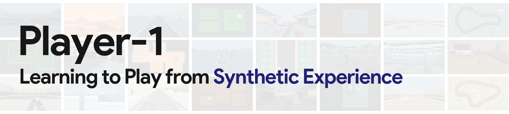
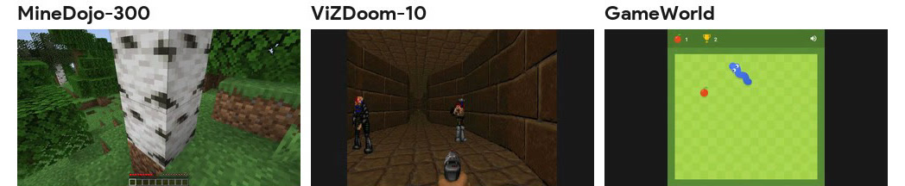

<p align="center">
  <a href="https://player-1-project.github.io/"></a>&nbsp;
  <a href="https://player-1-project.github.io/assets/player-1.pdf"></a>&nbsp;
  &nbsp;
  
</p>

**Player-1** is an agentic post-training pipeline for learning general game control. Its workflow includes:

- **Supervised fine-tuning (SFT)** on **Player-1-Data**, curated gameplay demonstrations that initialize computer-use models for game control.
- **Reinforcement learning (RL)** in **Player-1-Gym**, a suite of sixteen synthetic environments, to build experience through interaction with verifiable rewards.
- **Evaluation on benchmarks** including **MineDojo-300**, **ViZDoom-10**, and **GameWorld** to assess transfer to games beyond the RL training suite.

https://github.com/user-attachments/assets/8b55b5f3-f93f-4d1d-a767-257de0f742c2

## 📢 News

- **[2026.10.14]** Released the [paper](https://player-1-project.github.io/assets/player-1.pdf) and [project page](https://player-1-project.github.io/).

## Player-1 Overview

Player-1 training and evaluation pipeline: **Computer-use model → SFT on Player-1-Data → RL in Player-1-Gym → Evaluation in external games**

### 1/ Player-1-Data

We curate **6,044 gameplay trajectories from 172 games**, with recorded keyboard and mouse actions mapped to a shared game-control action space. Each training example includes task instructions, screenshot observations, reasoning, and actions for supervised learning.

### 2/ Player-1-Gym

**Sixteen synthetic 2D and 3D environments** cover aiming, combat, driving, navigation, and UI interaction. All use screenshot observations and keyboard and mouse controls, with verifiable rewards computed directly from game state. Randomizing **appearance, camera, scene, and control** broadens the agent's training experience.

### 3/ Evaluation Benchmarks

We evaluate transfer to games outside the RL training suite:



- **[MineDojo-300](https://github.com/MineDojo/MineDojo) (300 tasks):** Goal-directed control in Minecraft's open-ended world.
- **[ViZDoom-10](https://github.com/Farama-Foundation/ViZDoom) (10 maps):** First-person navigation, aiming, and combat in ViZDoom.
- **[GameWorld](https://github.com/gameworld-project/GameWorld) (170 tasks):** Game control across 34 browser games with diverse mechanics.

## 🚀 Release Plan

> [!IMPORTANT]
> We are actively preparing the following releases. Thank you for starring 🌟 this repo and following our updates!

- [x] [Paper](https://player-1-project.github.io/assets/player-1.pdf) & [Project page](https://player-1-project.github.io/)
- [ ] Player-1-Data demonstration dataset
- [ ] Player-1-Gym environments
- [ ] Model checkpoints: Player-1-9B and Player-1-35B-A3B
- [ ] Training and evaluation code

## Citation

If you find our work useful, please consider citing us!

```bibtex
@misc{ouyang2026player1,
  title = {Player-1: Learning to Play from Synthetic Experience},
  author = {Ouyang, Mingyu and Wang, Yiran and Hu, Siyuan and Yin, Xingyilang and Sun, Huiqiang and Wang, Guangzhi and Pu, Junfu and Cheng, Cheng and Chen, Honghao and Shan, Ying and Shou, Mike Zheng and Ng, Hwee Tou},
  year = {2026}
}
```
