<div align="center">

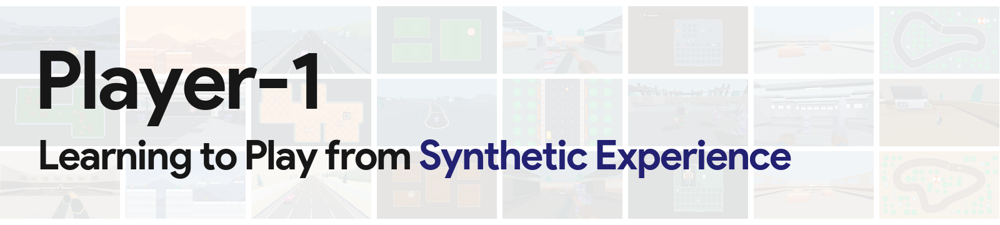

**Player-1** is an open VLM post-training framework for generalist game-playing agents, following:<br>**SFT on Player-1-Data → RL in Player-1-Gym → Evaluation on held-out gameplay benchmarks**.

[](https://player-1-project.github.io/)
[](https://arxiv.org/abs/2610.20584)
[](https://huggingface.co/datasets/yyyang/Player-1-Data)
<br>
[](https://huggingface.co/yyyang/Player-1-9B)
[](https://huggingface.co/yyyang/Player-1-35B-A3B)
[](LICENSE)

</div>

---

Core components of the **Player-1** framework:
- **Player-1-Data:** [6,044 curated trajectories from 172 games](https://huggingface.co/datasets/yyyang/Player-1-Data), complete with screenshots, chain-of-thought reasoning, and normalized keyboard/mouse actions.
- **Player-1-Gym:** 16 synthetic 2D/3D environments for aiming, combat, driving, navigation, and UI crafting with verifiable rewards.
- **Training Engine:** [VeRL](https://github.com/verl-project/verl) integration supporting PPO, GRPO, and GSPO. Base models: Qwen3.5-9B / Qwen3.5-35B-A3B.
- **Gameplay Evaluation Suite:** Evaluation across Player-1-Gym, MineDojo (300 tasks), ViZDoom (10 maps), and GameWorld (170 tasks).

### 🎮 RL Training Environment Previews

<table>
<tr>
  <th width="25%"><strong>2D Aiming</strong></th>
  <th width="25%"><strong>2D Shooting</strong></th>
  <th width="25%"><strong>2D Collect &amp; Dodge</strong></th>
  <th width="25%"><strong>2D Lane Driving</strong></th>
</tr>
<tr>
  <td>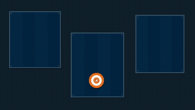</td>
  <td>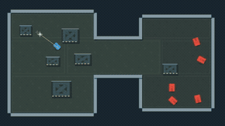</td>
  <td>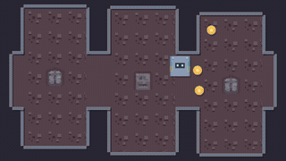</td>
  <td>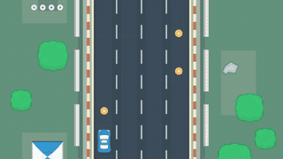</td>
</tr>
<tr>
  <th><strong>2D Circuit Driving</strong></th>
  <th><strong>2D Platforming</strong></th>
  <th><strong>2D Crafting</strong></th>
  <th><strong>3D Aiming</strong></th>
</tr>
<tr>
  <td>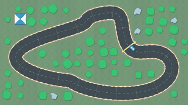</td>
  <td>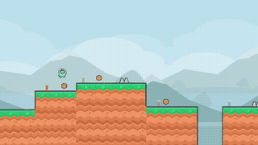</td>
  <td>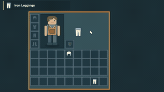</td>
  <td>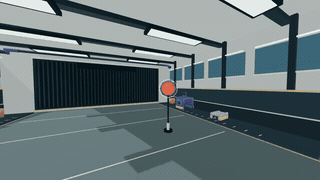</td>
</tr>
<tr>
  <th><strong>3D Shooting</strong></th>
  <th><strong>3D Road Driving</strong></th>
  <th><strong>3D Lane Driving</strong></th>
  <th><strong>3D Spear Duel</strong></th>
</tr>
<tr>
  <td>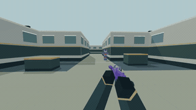</td>
  <td>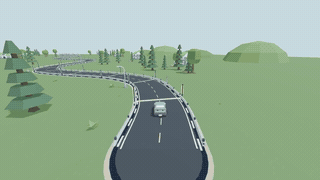</td>
  <td>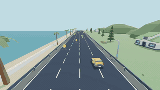</td>
  <td>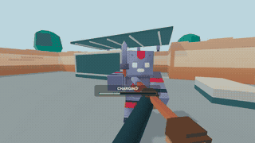</td>
</tr>
<tr>
  <th><strong>3D Sword Duel</strong></th>
  <th><strong>3D Melee Combat</strong></th>
  <th><strong>3D Navigation</strong></th>
  <th><strong>3D Chasing</strong></th>
</tr>
<tr>
  <td>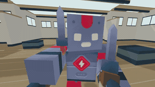</td>
  <td>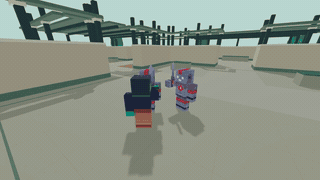</td>
  <td>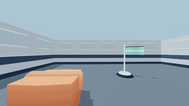</td>
  <td>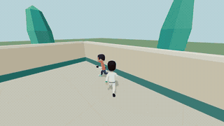</td>
</tr>
</table>

https://github.com/user-attachments/assets/8b55b5f3-f93f-4d1d-a767-257de0f742c2

---

## 📢 News

- **[2026.11]** Released Player-1 models, Player-1-Data, and the complete Player-1 codebase: Player-1-Gym, training recipes (SFT & RL), and benchmark evaluators.
- **[2026.10]** Released the [paper (arXiv 2610.20584)](https://arxiv.org/abs/2610.20584) and [project page](https://player-1-project.github.io/).

---

## ⚡ Quick Start

Play the 16 Gym environments directly in your browser. Use Python 3.11+ and run from the repository root:

```bash
python -m pip install -r requirements/gym.txt
python -m playwright install chromium
PYTHONPATH=. python examples/gym/play.py
```

Open the printed URL in your browser to play manually.

For Python programmatic stepping, run [examples/gym/step.py](examples/gym/step.py):

```python
import asyncio
from player1.gym import GymEnv

async def main():
    async with GymEnv("base_3d_aim") as env:
        obs = await env.reset(seed=42)
        # Relative mouse movement [-1000, 1000] and click
        obs = await env.step({
            "type": "game_step_action", "id": "control", "duration_ms": 200,
            "mouse": {"mode": "relative", "dx": 50, "dy": -20},
            "mouse_click": {"button": "left"},
        })
        print(f"Reward: {obs.reward}, Terminated: {obs.terminated}")

asyncio.run(main())
```

---

## 📚 Guides & Documentation

| Workflow | Guide / Entry Points | Description |
| :--- | :--- | :--- |
| **Gym** | [Setup and Python API](docs/GYM.md) | 16 environments, continuous initialization, and action specs |
| **Data** | [Reading and format](docs/DATA.md) · [Production and Viewer](docs/DATA_PRODUCTION.md) | Parquet schema, multi-turn history reader, and VLM annotation |
| **Inference** | [Model server and examples](docs/MODELS.md) | vLLM serving, prompt templates, and single-frame/interactive agent |
| **Training** | [SFT → RL guide](docs/TRAINING.md) · [SFT launcher](scripts/training/run_sft.sh) · [RL launcher](scripts/training/run_rl.sh) | veRL integration, PPO/GRPO/GSPO, and checkpoint export |
| **Evaluation** | [Benchmark setup and trajectory viewer](docs/EVALUATION.md) | MineDojo-300, ViZDoom-10, GameWorld, and web-based viewer |
| **Sources** | [Component sources and licenses](docs/SOURCES.md) | Upstream projects and asset notices |

---

## Player-1 Overview

Player-1 training and evaluation pipeline: **Computer-use model → SFT on Player-1-Data → RL in Player-1-Gym → Evaluation in external games**

### 1/ Player-1-Data

We curate **6,044 gameplay trajectories from 172 games**, with recorded keyboard and mouse actions mapped to a shared game-control action space. Each training example includes task instructions, screenshot observations, reasoning, and actions for supervised learning.

### 2/ Player-1-Gym

**Sixteen synthetic 2D and 3D environments** cover aiming, combat, driving, navigation, and UI interaction. All use screenshot observations and keyboard and mouse controls, with verifiable rewards computed directly from game state. Randomizing **appearance, camera, scene, and control** broadens the agent's training experience.

### 3/ Evaluation Benchmarks

We evaluate transfer to games outside the RL training suite:

<table>
<tr>
  <th width="33%"><strong>Minecraft</strong></th>
  <th width="33%"><strong>ViZDoom</strong></th>
  <th width="33%"><strong>GameWorld</strong></th>
</tr>
<tr>
  <td>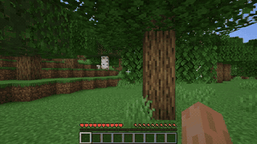</td>
  <td>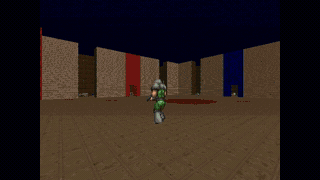</td>
  <td>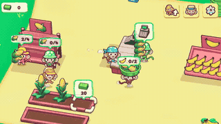</td>
</tr>
</table>

- **[MineDojo](https://github.com/MineDojo/MineDojo) (MineDojo-300, 300 tasks, 1000 turns per step):** Goal-directed control in Minecraft's open-ended world.
- **[ViZDoom](https://github.com/Farama-Foundation/ViZDoom) (ViZDoom-10, 10 maps, 150–2,100 turns per step):** First-person navigation, aiming, and combat in ViZDoom.
- **[GameWorld](https://github.com/gameworld-project/GameWorld) (170 tasks, 400 turns per step):** Game control across 34 browser games with diverse mechanics.


---

## 🚀 Release Status

- [x] **Launch: [Paper](https://arxiv.org/abs/2610.20584)** & **[Project Page](https://player-1-project.github.io/)**
- [x] **Demonstration SFT Dataset**: [Hugging Face](https://huggingface.co/datasets/yyyang/Player-1-Data).
- [x] **Model Checkpoints**: [Player-1-9B](https://huggingface.co/yyyang/Player-1-9B) and [Player-1-35B-A3B](https://huggingface.co/yyyang/Player-1-35B-A3B).
- [x] **Player-1-Gym**: 16 synthetic 2D/3D environments with Python Playwright bindings.
- [x] **Player-1-Data Pipeline**: Ingestion, action standardization, and VLM annotation.
- [x] **Training Framework**: VeRL-based SFT and RL (PPO / GRPO / GSPO) recipes for Qwen3.5-9B / Qwen3.5-35B-A3B.
- [x] **Evaluation & Benchmark**: Player-1-Gym, MineDojo-300, ViZDoom-10, and GameWorld.


---

## 📑 Citation

If you find our work or dataset useful, please consider citing:

```bibtex
@misc{ouyang2026player1learningplaysynthetic,
  title={Player-1: Learning to Play from Synthetic Experience},
  author={Mingyu Ouyang and Yiran Wang and Siyuan Hu and Xingyilang Yin and Huiqiang Sun and Guangzhi Wang and Junfu Pu and Cheng Cheng and Honghao Chen and Ying Shan and Mike Zheng Shou and Hwee Tou Ng},
  year={2026},
  eprint={2610.20584},
  archivePrefix={arXiv},
  primaryClass={cs.CV},
  url={https://arxiv.org/abs/2610.20584}
}
```
