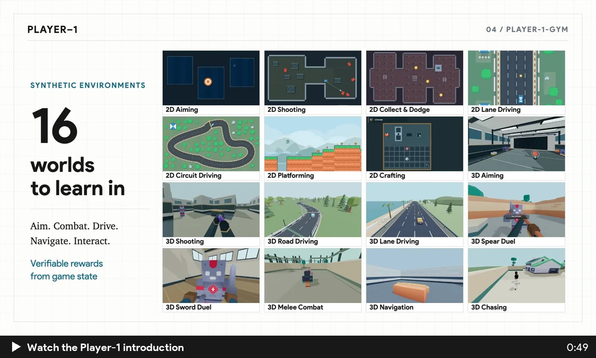

# Player-1: Learning to Play from Synthetic Experience

   

**Player-1** is an agentic post-training framework for learning general game control. It combines supervised fine-tuning (SFT) on gameplay demonstrations with reinforcement learning (RL) in **Player-1-Gym**, sixteen synthetic environments, to build experience that transfers to games beyond the training suite.

[▶ Watch the introduction · 49 seconds](assets/player1-introduction.mp4)

## 📢 News

- **[2026.10.14]** The [paper](https://player-1-project.github.io/assets/player-1.pdf) and [project page](https://player-1-project.github.io/) are available!

## 0/ Overview

**Computer-use model → SFT with Player-1 Data → RL in Player-1-Gym → Evaluation in external games**

### 1/ Player-1 Data

We curate **6,044 gameplay trajectories from 172 games**, aligning recorded keyboard and mouse controls with a shared game-control action space. Task instructions, screenshot observations, and visual reasoning turn demonstrations into supervised learning examples. This provides the SFT initialization for learning through interaction.

### 2/ Player-1-Gym

**Sixteen synthetic 2D and 3D environments** cover aiming, combat, driving, navigation, and UI interaction. They share screenshot observations and keyboard–mouse controls, with verifiable rewards computed directly from game state. Randomizing **appearance, camera, scene, and control** broadens the experience available for reinforcement learning.

### 3/ Evaluation Benchmarks

We evaluate transfer to games outside the RL training suite:

- **MineDojo-300:** 300 Minecraft tasks testing goal-directed control, including harvesting and combat.
- **ViZDoom-10:** ten maps testing first-person navigation, aiming, and combat.
- **[GameWorld](https://github.com/gameworld-project/GameWorld):** 170 tasks across 34 browser games testing varied mechanics and interaction.

Explore [recorded trajectories, reasoning, and actions](https://player-1-project.github.io/#trajectories) on the project page.

## 🚀 Release Timeline

We are actively preparing the following releases. Star this repository to follow the release progress :)

- [x] [Paper](https://player-1-project.github.io/assets/player-1.pdf)
- [x] [Project page](https://player-1-project.github.io/)
- [ ] Player-1 Data demonstration dataset
- [ ] Player-1-Gym environments
- [ ] Model checkpoints
- [ ] Training/evaluation code
