# Player-1-Gym

Sixteen 2D and 3D synthetic environments with continuous initialization in 3D Aiming, Navigation, and Road Driving. Use Python 3.11+ and run from the repository root.

```bash
python -m pip install -r requirements/gym.txt
python -m playwright install chromium
PYTHONPATH=. python examples/gym/play.py
```

Open the printed URL to play in your browser. Run `PYTHONPATH=. python examples/gym/step.py` for a Python stepping example.

---

## 🎮 Environment Suite

<table>
<tr>
  <th width="25%"><strong>2D Aiming</strong></th>
  <th width="25%"><strong>2D Shooting</strong></th>
  <th width="25%"><strong>2D Collect &amp; Dodge</strong></th>
  <th width="25%"><strong>2D Lane Driving</strong></th>
</tr>
<tr>
  <td>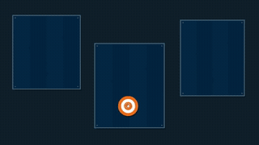</td>
  <td>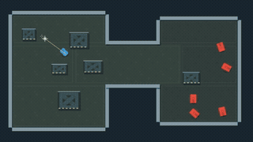</td>
  <td>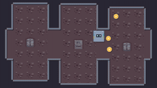</td>
  <td>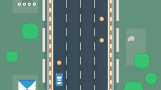</td>
</tr>
<tr>
  <th><strong>2D Circuit Driving</strong></th>
  <th><strong>2D Platforming</strong></th>
  <th><strong>2D Crafting</strong></th>
  <th><strong>3D Aiming</strong></th>
</tr>
<tr>
  <td>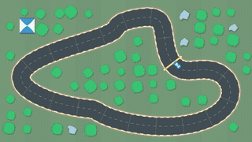</td>
  <td>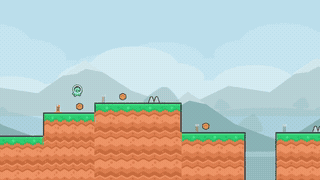</td>
  <td>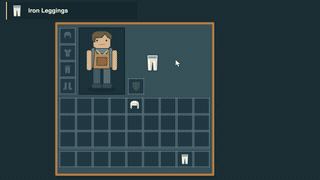</td>
  <td>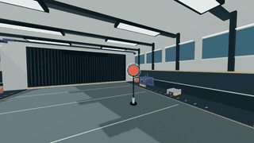</td>
</tr>
<tr>
  <th><strong>3D Shooting</strong></th>
  <th><strong>3D Road Driving</strong></th>
  <th><strong>3D Lane Driving</strong></th>
  <th><strong>3D Spear Duel</strong></th>
</tr>
<tr>
  <td>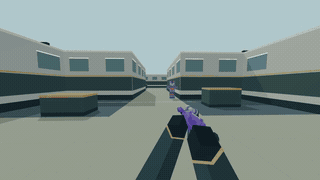</td>
  <td>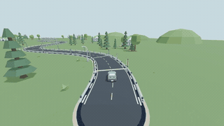</td>
  <td>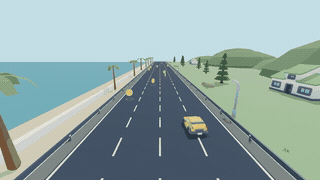</td>
  <td>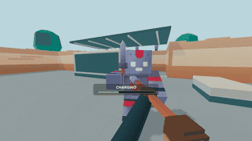</td>
</tr>
<tr>
  <th><strong>3D Sword Duel</strong></th>
  <th><strong>3D Melee Combat</strong></th>
  <th><strong>3D Navigation</strong></th>
  <th><strong>3D Chasing</strong></th>
</tr>
<tr>
  <td>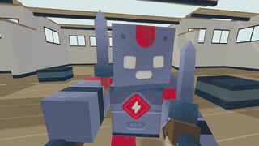</td>
  <td>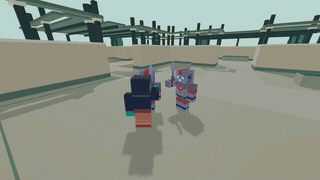</td>
  <td>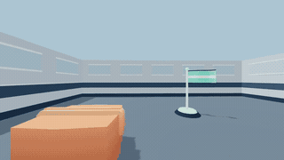</td>
  <td>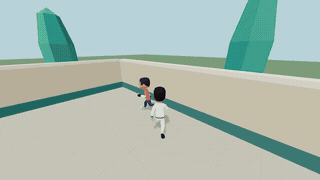</td>
</tr>
</table>

| Category | Environment ID | Dim | Key Mechanics | Objective |
| :--- | :--- | :---: | :--- | :--- |
| **Aiming & Shooting** | `base_2d_aim` | 2D | Mouse aim & click | Hit active targets near their centers |
| | `base_2d_aim_arena` | 2D | Movement, aiming & cover | Shoot moving enemies around obstacles |
| | `base_3d_aim` | 3D | 3D camera pan/tilt & crosshair fire | Acquire and shoot active 3D targets |
| **Combat & Arena** | `base_3d_combat_arena`| 3D | Movement, projectile aiming & cover | Hit continuously respawning enemies |
| | `base_3d_duel` | 3D | Crosshair tracking & charged spear thrusts | Charge, aim and release to hit an evasive opponent |
| | `base_3d_duel_precision` | 3D | Sword aiming, pursuit & dodging | Move within reach and slash an evasive opponent |
| | `base_3d_melee_arena` | 3D | Close-quarters movement & attack | Engage targets with melee swings |
| **Driving & Steering** | `base_2d_drive_lane_collect`| 2D | Four-lane steering | Collect approaching road coins |
| | `base_2d_drive_planar_wasd` | 2D | Top-down vehicle physics | Navigate checkpoints without colliding |
| | `base_3d_drive` | 3D | 3D vehicle physics & acceleration | Drive through highway waypoints |
| | `base_3d_drive_lane` | 3D | Four-lane steering | Collect road coins while staying on the road |
| **Navigation & Platform** | `base_2d_platform` | 2D | Running, jumping & route selection | Collect coins across terrain, pits and spikes |
| | `base_2d_arcade_planar` | 2D | Four-direction movement & obstacle avoidance | Collect coins |
| | `base_3d_movement` | 3D | Camera-relative movement around low obstacles | Reach the flag as it relocates around the room |
| | `base_3d_navigate_chase` | 3D | Target pursuit & line-of-sight tracking | Track and catch fleeing targets |
| **UI & Crafting** | `base_2d_ui_crafting` | 2D | Click-based inventory, recipes & furnace controls | Complete crafting, smelting and equipment requests |

---

## Python API

```python
import asyncio
from player1.gym import GymEnv

async def main():
    async with GymEnv("base_3d_aim") as env:
        observation = await env.reset(seed=42)
        observation.image.save("initial.png")
        observation = await env.step({
            "type": "game_step_action", "id": "wait", "duration_ms": 200,
        })
        print(observation.reward, observation.terminated)

asyncio.run(main())
```

---

## Observation & Action Space

### Observations
Observations include an RGB image, reward, terminal flags, and game state in `observation.info["state"]`. Each action advances the paused game by its duration before capturing the next screenshot.

### Canonical Actions

Pass a `game_step_action` dictionary with a nonempty `id` to `env.step()`. Set `duration_ms` to the desired step length, usually 200 ms, and combine the input fields supported by the selected game.

```python
action = {
    "type": "game_step_action",
    "id": "control",
    "duration_ms": 200,
    "key_hold": ["w"],
    "mouse": {"mode": "relative", "dx": 50, "dy": 0},
    "mouse_click": {"button": "left"},
}
```

- `key_hold` and `key_tap` contain key names such as `"w"`, `"space"` and `"arrowleft"`. Repeat `key_hold` on successive steps to continue holding a key.
- `mouse` selects absolute coordinates with `{"mode": "absolute", "x": 500, "y": 500}` or relative movement with `{"mode": "relative", "dx": 50, "dy": 0}`. Absolute coordinates use `[0, 1000]`. Relative displacements use `[-1000, 1000]`, where 1000 is one observation width or height.
- `mouse_click` and `mouse_hold` take a button dictionary such as `{"button": "left"}`. Repeat `mouse_hold` across steps to continue holding, then omit it to release.
- `{"type": "game_step_action", "id": "wait", "duration_ms": 200}` waits for one step.

`reset(options=...)` selects game-specific randomization. Record the seed and options with reported results.

For model evaluation and saved trajectories, see [Evaluation](EVALUATION.md) and its shared [viewer](EVALUATION.md#trajectory-viewer).
